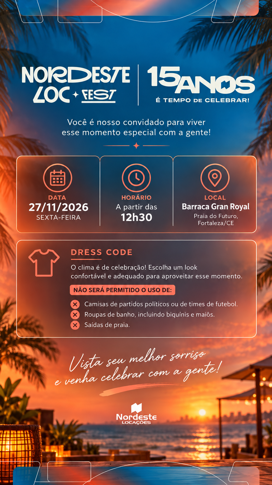

# Nordeste Loc Fest · 15 anos

Convite digital da celebração dos 15 anos da **Nordeste Locações**. A página exibe a arte final fornecida pela organização, sem recriar ou alterar seu visual.



## Evento

- **Data:** 27/11/2026, sexta-feira.
- **Horário:** a partir das 12h30.
- **Local:** Barraca Gran Royal, Praia do Futuro, Fortaleza/CE.
- **Dress code:** look confortável e adequado à celebração.

Não será permitido o uso de camisas de partidos políticos ou de times de futebol, roupas de banho (incluindo biquínis e maiôs) ou saídas de praia.

## Interface

A arte aparece inteira, sem cortes ou distorções, com largura máxima de 941 pixels e adaptação proporcional em telas menores. O bloco de localização é clicável e abre uma busca pelo estabelecimento no mapa. As informações também estão disponíveis em texto para leitores de tela.

Não há formulário de presença, mural, playlist, painel, cabeçalho ou rodapé adicional. A página não coleta dados nem utiliza o armazenamento local do navegador. A exibição do convite não depende de fontes externas.

## Desenvolvimento

Com Bun, usando o lockfile versionado:

```sh
bun install --frozen-lockfile
bun run dev
```

Ou com Node.js e npm compatíveis com a versão instalada do Vite:

```sh
npm install
npm run dev
```

Acesse a URL informada no terminal. A porta inicial é 3000; se estiver ocupada, o Vite usa a próxima disponível. Não são necessários arquivo `.env` ou chaves de API.

## Comandos

| Comando | Finalidade |
| --- | --- |
| `bun run dev` | Desenvolvimento local. |
| `bun run lint` | Verificação de tipos. |
| `bun run build` | Build de produção em `dist/`. |
| `bun run preview` | Conferência local do build. |
| `bun run clean` | Limpeza de `dist/`, compatível com Windows. |

Com npm, substitua `bun run` por `npm run`.

## Arquivos principais

- `src/assets/images/nordeste-loc-fest-convite-final.png`: arte final exibida na página.
- `src/App.tsx`: convite, texto acessível e link do mapa.
- `src/index.css`: dimensionamento e posicionamento da área clicável.
- `src/event.ts`: informações acessíveis e destino do mapa.
- `index.html`: título e descrição para compartilhamento.

Como os textos visuais fazem parte da imagem, mudanças de data, local ou regras exigem uma nova arte. Atualize também `src/event.ts`, o texto acessível e os metadados. Se a composição da arte mudar, ajuste a área clicável do mapa em `src/index.css`.

`BAILE_NORDESTE_15_ANOS.html` é uma versão estática com a mesma arte. Não entra automaticamente no build do React; mantenha a imagem no caminho relativo indicado se for distribuí-la separadamente.

## Publicação

```sh
bun run lint
bun run build
```

Publique o conteúdo de `dist/` em uma hospedagem estática. Se usar um subdiretório, ajuste `base` em `vite.config.ts` antes de gerar o build. O mapa depende de conexão com a internet.
